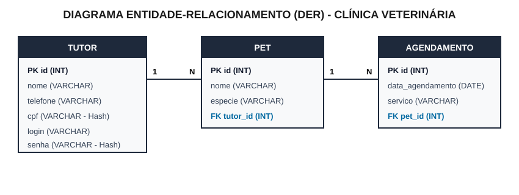

# 📘 Tutorial Passo a Passo — Prova Prática SAEP (Python + FastAPI)

🌐 **Acesse o Tutorial Interativo Online (GitHub Pages):**  
👉 **[https://instrutorrafaelreis.github.io/SAEPTDS/](https://instrutorrafaelreis.github.io/SAEPTDS/)**

---

**Curso:** Técnico em Desenvolvimento de Sistemas  
**Tema:** Sistema de Gestão para Clínica Veterinária (Tutores, Pets e Agendamentos)  
**Objetivo:** Garantir de **80% a 100% da nota** escrevendo o menor e mais simples código possível, sem perder tempo com CSS ou JavaScript.

---

## 🎯 A Estratégia para Passar com Folga (37 Pontos no Total)

Na prova prática do SAEP você tem **3 horas**. A prova **não avalia beleza visual (CSS)**, ela avalia **funcionalidade**.

Por isso, nossa estratégia usa **4 atalhos inteligentes**:
1. **Zero JavaScript e Zero CSS:** Usaremos apenas `<form>` puro do HTML dentro do próprio FastAPI (`HTMLResponse`).
2. **Apenas 1 arquivo Python (`sistema/main.py`):** Você não precisa criar pastas de templates, arquivos `.js` ou `.css`.
3. **Apenas 3 tabelas (`tutor`, `pet`, `agendamento`):** Como o edital pede que o Tutor tenha CPF e Senha criptografados, usamos a própria tabela `tutor` para fazer o Login do sistema.
4. **Edição direto na tabela:** Em vez de criar uma tela nova só para editar o Tutor ou mudar a data do Agendamento, colocamos os campos `<input>` dentro da própria linha da tabela (`<tr>`).

### 📁 Estrutura de Arquivos que você deve entregar na pasta da prova:
```text
Pasta_Da_Entrega/
 ├── documentacao.txt       (Entrega 1: Requisitos Funcionais e Infraestrutura)
 ├── der.svg ou der.pdf     (Entrega 2: Diagrama Entidade-Relacionamento)
 ├── saep_db.sql            (Entrega 3: Script SQL de criação e população)
 └── sistema/               (Entregas 4 a 8: Pasta obrigatória com nome "sistema")
      ├── venv/             (Ambiente virtual Python)
      ├── requirements.txt  (Lista de bibliotecas utilizadas)
      └── main.py           (Código-fonte completo do sistema)
```

---

## ⚙️ PASSO 0: Criando o Ambiente Virtual (`venv`) e Instalando as Bibliotecas

Antes de começar a programar o sistema, crie a pasta **`sistema`**, entre nela pelo terminal do VS Code (`Ctrl + '`) e configure o **Ambiente Virtual (`venv`)**:

```powershell
# 1. Cria a pasta obrigatória chamada "sistema" e entra nela
mkdir sistema
cd sistema

# 2. Cria o ambiente virtual chamado "venv"
python -m venv venv

# 3. Ativa o ambiente virtual no Windows (PowerShell / CMD)
.\venv\Scripts\activate

# 4. Instala as 3 bibliotecas necessárias para o projeto
pip install fastapi uvicorn python-multipart
```

> **💡 Dica caso o PowerShell bloqueie a ativação do `venv`:**  
> Se aparecer um erro vermelho de *ExecutionPolicy*, rode antes:  
> `Set-ExecutionPolicy -Scope Process -ExecutionPolicy Bypass`  
> E depois rode `.\venv\Scripts\activate` novamente.

### 🔍 Para que serve cada comando e biblioteca instalada?
* **`python -m venv venv`**: Cria uma pasta isolada (`venv`) apenas para as bibliotecas do seu projeto, evitando conflitos com outros programas do computador.
* **`fastapi`**: É o framework web que cria as rotas do sistema (`@app.get`, `@app.post`) de forma rápida e simples.
* **`uvicorn`**: É o servidor web local que coloca o código do FastAPI no ar no endereço `http://127.0.0.1:8000`.
* **`python-multipart`**: **MUITO IMPORTANTE!** O FastAPI exige essa biblioteca sempre que usamos `Form()` para receber dados enviados por formulários HTML (`<form method="post">`). Sem ela, o FastAPI dá erro ao receber formulários!
* **`sqlite3` e `hashlib`**: **Não precisam de `pip install`** porque já vêm embutidas por padrão no próprio Python!

---

## 📝 PASSO 1: Documentação de Software (Vale 3 Pontos)
> **Itens avaliados:**  
> - **1.1 (Peso 2):** Identificar no mínimo 4 requisitos funcionais.  
> - **1.2 (Peso 1):** Identificar os requisitos de infraestrutura (SGBD e Linguagem).

O caderno de prova permite entregar em formato **`.txt`**, `.docx` ou `.pdf`. Crie um arquivo chamado **`documentacao.txt`** (fora da pasta `sistema`, na raiz da entrega):

```text
1.1 REQUISITOS FUNCIONAIS DO SISTEMA (Mínimo 4)
- RF01: O sistema deve permitir o login de usuários validando as credenciais no banco de dados, exibindo mensagem de erro em caso de falha e criando sessão com tempo de expiração.
- RF02: O sistema deve exibir na tela principal o nome do usuário logado na sessão, links para os módulos "Tutor", "Pet" e "Agendamento", e opção para sair do sistema (logout).
- RF03: O sistema deve permitir cadastrar, listar, buscar por termo, editar e excluir tutores, salvando CPF e senha criptografados no banco de dados (LGPD).
- RF04: O sistema deve permitir cadastrar e listar pets associando obrigatoriamente cada pet a um tutor existente.
- RF05: O sistema deve permitir cadastrar agendamentos, atualizar a data de um agendamento e listar os agendamentos ordenados por data exibindo os dados do tutor e do pet.

1.2 LISTA DE REQUISITOS DE INFRAESTRUTURA
- Linguagem de Programação: Python 3 (com framework FastAPI)
- Sistema Gerenciador de Banco de Dados (SGBD): MySQL / SQLite3
- Servidor Web: Uvicorn
- Editor de Código / IDE: VS Code
```

---

## 🗂️ PASSO 2: Diagrama Entidade-Relacionamento - DER (Vale 1 Ponto)
> **Item avaliado:**  
> - **1.3 (Peso 1):** Gerar o Diagrama Entidade-Relacionamento conforme descrito no caderno.



### 🔍 Explicação do Diagrama DER:
* **Tabela `TUTOR`**: Guarda os dados do dono do animal (`id`, `nome`, `telefone`, `cpf`, `login`, `senha`). Aqui `id` é a **Chave Primária (`PK`)**.
* **Tabela `PET`**: Guarda os dados do animal (`id`, `nome`, `especie`, `tutor_id`). Como todo pet pertence a um tutor, a coluna `tutor_id` é uma **Chave Estrangeira (`FK`)** que aponta para `tutor(id)` — relação **1 para N** (1 tutor pode ter vários pets).
* **Tabela `AGENDAMENTO`**: Guarda a data e o serviço (`id`, `data_agendamento`, `servico`, `pet_id`). A coluna `pet_id` é uma **Chave Estrangeira (`FK`)** que aponta para `pet(id)` — relação **1 para N** (1 pet pode ter vários agendamentos).

---

## 🗄️ PASSO 3: Script do Banco de Dados `saep_db.sql` (Vale 3 Pontos)
> **Itens avaliados:**  
> - **2.1 (Peso 2):** Criar as tabelas respeitando a chave estrangeira (`FOREIGN KEY`) de cada relacionamento.  
> - **2.2 (Peso 1):** Inserir pelo menos **3 registros em cada uma das tabelas**.

Crie o arquivo **`saep_db.sql`** na raiz da entrega:

```sql
CREATE DATABASE IF NOT EXISTS saep_db;
USE saep_db;

-- 1. Tabela TUTOR
CREATE TABLE IF NOT EXISTS tutor (
    id INT AUTO_INCREMENT PRIMARY KEY,
    nome VARCHAR(100) NOT NULL,
    telefone VARCHAR(20) NOT NULL,
    cpf VARCHAR(64) NOT NULL,
    login VARCHAR(50) NOT NULL,
    senha VARCHAR(64) NOT NULL
);

-- 2. Tabela PET (Chave Estrangeira para tutor)
CREATE TABLE IF NOT EXISTS pet (
    id INT AUTO_INCREMENT PRIMARY KEY,
    nome VARCHAR(100) NOT NULL,
    especie VARCHAR(50) NOT NULL,
    tutor_id INT NOT NULL,
    FOREIGN KEY (tutor_id) REFERENCES tutor(id) ON DELETE CASCADE
);

-- 3. Tabela AGENDAMENTO (Chave Estrangeira para pet)
CREATE TABLE IF NOT EXISTS agendamento (
    id INT AUTO_INCREMENT PRIMARY KEY,
    data_agendamento DATE NOT NULL,
    servico VARCHAR(100) NOT NULL,
    pet_id INT NOT NULL,
    FOREIGN KEY (pet_id) REFERENCES pet(id) ON DELETE CASCADE
);

-- INSERÇÃO DE 3 REGISTROS EM CADA TABELA (Item 2.2)
-- Obs: O hash SHA-256 da senha abaixo corresponde a '123'
INSERT INTO tutor (nome, telefone, cpf, login, senha) VALUES
('Ana Silva', '11999990001', '2c624232cdd221771294dfbb310aca000a0df6ac8b66b696d90ef06fdefb64a3', 'ana', 'a665a45920422f9d417e4867efdc4fb8a04a1f3fff1fa07e998e86f7f7a27ae3'),
('Carlos Souza', '11999990002', '6b86b273ff34fce19d6b804eff5a3f5747ada4eaa22f1d49c01e52ddb7875b4b', 'carlos', 'a665a45920422f9d417e4867efdc4fb8a04a1f3fff1fa07e998e86f7f7a27ae3'),
('Mariana Costa', '11999990003', 'd4735e3a265e16eee03f59718b9b5d03019c07d8b6c51f90da3a666eec13ab35', 'mariana', 'a665a45920422f9d417e4867efdc4fb8a04a1f3fff1fa07e998e86f7f7a27ae3');

INSERT INTO pet (nome, especie, tutor_id) VALUES
('Rex', 'Cachorro', 1),
('Mimi', 'Gato', 2),
('Thor', 'Cachorro', 3);

INSERT INTO agendamento (data_agendamento, servico, pet_id) VALUES
('2026-05-20', 'Consulta Geral', 1),
('2026-03-10', 'Vacinação', 2),
('2025-11-05', 'Banho e Tosa', 3);
```

### 🔍 Explicação do Código SQL:
* **`AUTO_INCREMENT PRIMARY KEY`**: Faz o banco gerar o número do `id` sozinho (1, 2, 3...) sem precisarmos digitar o ID no cadastro.
* **`VARCHAR(64)` em `cpf` e `senha`**: Como o algoritmo `SHA-256` transforma qualquer texto em um código criptografado de 64 caracteres, usamos `VARCHAR(64)`.
* **`FOREIGN KEY (tutor_id) REFERENCES tutor(id) ON DELETE CASCADE`**: Cria o vínculo obrigatório entre Pet e Tutor (Item 2.1). O `ON DELETE CASCADE` evita erros quando você clicar em "Excluir Tutor" na tela: se um tutor for excluído, o banco apaga automaticamente os pets vinculados a ele sem travar o sistema!

---

## 💻 PASSO 4: Criando o Sistema em Python + FastAPI (Vale 29 Pontos)

Dentro da pasta **`sistema`**, crie o arquivo **`main.py`**.  
Abaixo estão os **6 blocos** do código com a explicação detalhada do que cada parte faz.

---

### 🔹 Bloco 1: Importações, Criptografia LGPD e Banco de Dados

```python
import hashlib
import sqlite3
from fastapi import FastAPI, Form, Request
from fastapi.responses import HTMLResponse, RedirectResponse

app = FastAPI()

# ITEM 5.4 (Peso 3): Criptografia de Senha e CPF (LGPD)
def criptografar(texto: str) -> str:
    return hashlib.sha256(texto.encode("utf-8")).hexdigest()

# Conexão com o banco de dados
def get_db():
    conn = sqlite3.connect("saep_db.sqlite")
    conn.row_factory = sqlite3.Row
    conn.execute("PRAGMA foreign_keys = ON")
    return conn

# Inicializa as tabelas e os 3 registros iniciais automaticamente
def inicializar_banco():
    conn = get_db()
    conn.executescript("""
        CREATE TABLE IF NOT EXISTS tutor (
            id INTEGER PRIMARY KEY AUTOINCREMENT,
            nome TEXT NOT NULL,
            telefone TEXT NOT NULL,
            cpf TEXT NOT NULL,
            login TEXT NOT NULL,
            senha TEXT NOT NULL
        );
        CREATE TABLE IF NOT EXISTS pet (
            id INTEGER PRIMARY KEY AUTOINCREMENT,
            nome TEXT NOT NULL,
            especie TEXT NOT NULL,
            tutor_id INTEGER NOT NULL,
            FOREIGN KEY (tutor_id) REFERENCES tutor(id) ON DELETE CASCADE
        );
        CREATE TABLE IF NOT EXISTS agendamento (
            id INTEGER PRIMARY KEY AUTOINCREMENT,
            data_agendamento TEXT NOT NULL,
            servico TEXT NOT NULL,
            pet_id INTEGER NOT NULL,
            FOREIGN KEY (pet_id) REFERENCES pet(id) ON DELETE CASCADE
        );
    """)
    if conn.execute("SELECT COUNT(*) FROM tutor").fetchone()[0] == 0:
        senha_padrao = criptografar("123")
        conn.executemany(
            "INSERT INTO tutor (nome, telefone, cpf, login, senha) VALUES (?, ?, ?, ?, ?)",
            [
                ("Ana Silva", "11999990001", criptografar("11111111111"), "ana", senha_padrao),
                ("Carlos Souza", "11999990002", criptografar("22222222222"), "carlos", senha_padrao),
                ("Mariana Costa", "11999990003", criptografar("33333333333"), "mariana", senha_padrao),
            ],
        )
        conn.executemany(
            "INSERT INTO pet (nome, especie, tutor_id) VALUES (?, ?, ?)",
            [("Rex", "Cachorro", 1), ("Mimi", "Gato", 2), ("Thor", "Cachorro", 3)],
        )
        conn.executemany(
            "INSERT INTO agendamento (data_agendamento, servico, pet_id) VALUES (?, ?, ?)",
            [
                ("2026-05-20", "Consulta Geral", 1),
                ("2026-03-10", "Vacinação", 2),
                ("2025-11-05", "Banho e Tosa", 3),
            ],
        )
        conn.commit()
    conn.close()

inicializar_banco()
```

#### 🔍 Entendendo o Código do Bloco 1:
* **`from fastapi import FastAPI, Form, Request`**:
  * `FastAPI`: Cria a aplicação web (`app = FastAPI()`).
  * `Form`: Permite receber os campos digitados nos formulários `<form method="post">`.
  * `Request`: Permite ler os cookies salvos no navegador (usado para saber quem está logado na sessão).
* **`from fastapi.responses import HTMLResponse, RedirectResponse`**:
  * `HTMLResponse`: Diz ao FastAPI para renderizar o texto retornado como uma página HTML de verdade no navegador (e não como JSON).
  * `RedirectResponse`: Redireciona o usuário de uma página para outra (ex.: após fazer login, manda para `/principal`).
* **`hashlib.sha256(texto.encode("utf-8")).hexdigest()`**: Converte o texto em bytes (`.encode("utf-8")`), aplica a criptografia padrão **SHA-256** e devolve o código hexadecimal de 64 caracteres (`.hexdigest()`). Atende 100% à exigência da **LGPD (Item 5.4 — Peso 3)**.
* **`conn.row_factory = sqlite3.Row`**: Permite acessar os dados vindos do banco pelo **nome da coluna** (ex.: `t['nome']`) em vez de usar números (`t[1]`), deixando o código muito mais fácil de ler.
* **`conn.execute("PRAGMA foreign_keys = ON")`**: Ativa a validação de chave estrangeira e o `ON DELETE CASCADE` no SQLite.
* **`if conn.execute("SELECT COUNT(*) FROM tutor").fetchone()[0] == 0:`**: Verifica se a tabela `tutor` está vazia. Se estiver vazia (primeira vez que o sistema roda), insere automaticamente os 3 tutores, 3 pets e 3 agendamentos!

---

### 🔹 Bloco 2: Funcionalidade de Login (Vale 6 Pontos)

```python
@app.get("/", response_class=HTMLResponse)
def tela_login(erro: str = ""):
    msg_erro = f"<p style='color:red;'><b>{erro}</b></p>" if erro else ""
    return f"""
    <h2>Login - Clínica Veterinária</h2>
    {msg_erro}
    <form method="post" action="/login">
        Login: <input name="login" required> <br><br>
        Senha: <input type="password" name="senha" required> <br><br>
        <button type="submit">Entrar</button>
    </form>
    """

@app.post("/login")
def fazer_login(login: str = Form(), senha: str = Form()):
    conn = get_db()
    user = conn.execute(
        "SELECT * FROM tutor WHERE login = ? AND senha = ?",
        (login, criptografar(senha)),
    ).fetchone()
    conn.close()

    # Item 3.3 (Peso 2): Validação em caso de falha no login
    if not user:
        return RedirectResponse("/?erro=Login+ou+senha+invalidos!", status_code=303)

    # Item 3.1 (Peso 1) e Item 3.2 (Peso 3): Redireciona e cria sessão com expiração (1800 segundos)
    res = RedirectResponse("/principal", status_code=303)
    res.set_cookie(key="usuario_sessao", value=user["nome"], max_age=1800)
    return res

@app.get("/logout")
def logout():
    # Item 4.2 (Peso 1): Sair do sistema apagando a sessão
    res = RedirectResponse("/", status_code=303)
    res.delete_cookie("usuario_sessao")
    return res
```

#### 🔍 Entendendo o Código do Bloco 2:
* **`@app.get("/", response_class=HTMLResponse)`**: Cria a rota inicial (`/`). Se houver um parâmetro `?erro=...` na URL, a variável `erro` recebe a mensagem e exibe em vermelho (`msg_erro`) — cumprindo o **Item 3.3 (Peso 2)**.
* **`login: str = Form(), senha: str = Form()`**: Pega exatamente o que o usuário digitou nos campos `<input name="login">` e `<input name="senha">`.
* **`(login, criptografar(senha))`**: Como a senha foi salva criptografada no banco, precisamos passar `criptografar(senha)` na hora do `SELECT` para comparar os dois hashes!
* **`status_code=303`**: No protocolo HTTP, quando um formulário `POST` termina e queremos redirecionar o navegador para uma página `GET`, usamos o código `303` (*See Other*).
* **`res.set_cookie(key="usuario_sessao", value=user["nome"], max_age=1800)`**: Cria a sessão do usuário autenticado salvando o nome dele no cookie `usuario_sessao` e definindo o tempo de expiração para **`1800` segundos (30 minutos)** — garantindo os **3 pontos do Item 3.2**!

---

### 🔹 Bloco 3: Funcionalidade Principal do Sistema (Vale 4 Pontos)

```python
@app.get("/principal", response_class=HTMLResponse)
def tela_principal(request: Request):
    # Item 4.1 (Peso 2): Recupera o nome do usuário salvo na sessão
    usuario = request.cookies.get("usuario_sessao")
    if not usuario:
        return RedirectResponse("/?erro=Sessao+expirada!", status_code=303)

    return f"""
    <h2>Tela Principal - Clínica Veterinária</h2>
    <p>Bem-vindo(a), <b>{usuario}</b>! | <a href="/logout">Sair do Sistema</a></p>
    <hr>
    <h3>Menu (Item 4.3):</h3>
    <ul>
        <li><a href="/tutores">Tutor</a></li>
        <li><a href="/pets">Pet</a></li>
        <li><a href="/agendamentos">Agendamento</a></li>
    </ul>
    """
```

#### 🔍 Entendendo o Código do Bloco 3:
* **`usuario = request.cookies.get("usuario_sessao")`**: Lê o cookie da sessão que criamos no login (**Item 4.1 — Peso 2**).
* **`if not usuario:`**: Se o usuário tentar entrar em `/principal` sem estar logado (ou depois que os 1800 segundos expirarem), o sistema bloqueia e manda de volta para a tela de login!
* **`<a href="/logout">Sair do Sistema</a>`**: Chama a rota `/logout` que apaga o cookie (`delete_cookie`), encerrando a sessão (**Item 4.2 — Peso 1**).
* **`<a href="/tutores">`, `/pets`, `/agendamentos`**: Links de navegação exigidos pelo **Item 4.3 (Peso 1)**.

---

### 🔹 Bloco 4: Gerenciamento de Tutor (Vale 13 Pontos — O Mais Importante!)

```python
@app.get("/tutores", response_class=HTMLResponse)
def listar_tutores(busca: str = ""):
    conn = get_db()
    # Item 5.2 (Peso 3): Busca por termo
    if busca:
        tutores = conn.execute("SELECT * FROM tutor WHERE nome LIKE ?", (f"%{busca}%",)).fetchall()
    else:
        tutores = conn.execute("SELECT * FROM tutor").fetchall()
    conn.close()

    linhas = ""
    for t in tutores:
        # Item 5.1 (Listar/Excluir) + Item 5.5 (Editar direto na linha da tabela!)
        linhas += f"""
        <tr>
            <form method="post" action="/tutores/editar">
                <td>{t['id']}<input type="hidden" name="id" value="{t['id']}"></td>
                <td><input name="nome" value="{t['nome']}" required></td>
                <td><input name="telefone" value="{t['telefone']}" required></td>
                <td><input name="login" value="{t['login']}" required></td>
                <td><small>{t['cpf'][:12]}...</small></td>
                <td>
                    <button type="submit">Salvar Edição</button>
                    <a href="/tutores/excluir/{t['id']}">Excluir</a>
                </td>
            </form>
        </tr>
        """

    return f"""
    <p><a href="/principal">Voltar para Principal</a></p>
    <h2>Gerenciamento de Tutores</h2>

    <!-- Item 5.3: Cadastro de novo tutor -->
    <form method="post" action="/tutores/criar">
        Nome: <input name="nome" required>
        Telefone: <input name="telefone" required>
        CPF: <input name="cpf" required>
        Login: <input name="login" required>
        Senha: <input type="password" name="senha" required>
        <button type="submit">Cadastrar Tutor</button>
    </form>
    <hr>

    <!-- Item 5.2: Formulário de Busca -->
    <form method="get" action="/tutores">
        Buscar tutor: <input name="busca" value="{busca}">
        <button type="submit">Buscar</button>
        <a href="/tutores">Limpar</a>
    </form>
    <br>

    <table border="1" cellpadding="5">
        <tr><th>ID</th><th>Nome</th><th>Telefone</th><th>Login</th><th>CPF (Criptografado)</th><th>Ações</th></tr>
        {linhas}
    </table>
    """

@app.post("/tutores/criar")
def criar_tutor(
    nome: str = Form(),
    telefone: str = Form(),
    cpf: str = Form(),
    login: str = Form(),
    senha: str = Form(),
):
    conn = get_db()
    # Item 5.3 e 5.4: Insere tutor criptografando CPF e Senha
    conn.execute(
        "INSERT INTO tutor (nome, telefone, cpf, login, senha) VALUES (?, ?, ?, ?, ?)",
        (nome, telefone, criptografar(cpf), login, criptografar(senha)),
    )
    conn.commit()
    conn.close()
    return RedirectResponse("/tutores", status_code=303)

@app.post("/tutores/editar")
def editar_tutor(id: int = Form(), nome: str = Form(), telefone: str = Form(), login: str = Form()):
    # Item 5.5 (Peso 3): Edita um tutor existente
    conn = get_db()
    conn.execute("UPDATE tutor SET nome = ?, telefone = ?, login = ? WHERE id = ?", (nome, telefone, login, id))
    conn.commit()
    conn.close()
    return RedirectResponse("/tutores", status_code=303)

@app.get("/tutores/excluir/{id}")
def excluir_tutor(id: int):
    # Item 5.1 (Peso 2): Exclui um tutor
    conn = get_db()
    conn.execute("DELETE FROM tutor WHERE id = ?", (id,))
    conn.commit()
    conn.close()
    return RedirectResponse("/tutores", status_code=303)
```

#### 🔍 Entendendo o Código do Bloco 4:
* **`WHERE nome LIKE ?` com `(f"%{busca}%",)`**: Os símbolos `%` antes e depois do texto buscado fazem o SQL procurar qualquer tutor que contenha aquela palavra em qualquer parte do nome (**Item 5.2 — Peso 3**).
* **Por que há um `<form method="post" action="/tutores/editar">` dentro do `<tr>`?**: Esse é o maior atalho da prova! Em vez de criar uma segunda tela de edição, cada linha da tabela já mostra o nome, telefone e login dentro de uma caixinha `<input>` editável, junto com um `<input type="hidden" name="id">` invisível que guarda o ID daquele tutor. Ao alterar qualquer letra e clicar em **Salvar Edição**, ele faz o `UPDATE` no banco (**Item 5.5 — Peso 3**).
* **`(nome, telefone, criptografar(cpf), login, criptografar(senha))`**: Ao criar um novo tutor, aplicamos `criptografar()` tanto no `cpf` quanto na `senha` antes de salvar no banco (**Itens 5.3 e 5.4 — 5 pontos somados**).

---

### 🔹 Bloco 5: Gerenciamento de Pets (Vale 3 Pontos)

```python
@app.get("/pets", response_class=HTMLResponse)
def listar_pets():
    conn = get_db()
    tutores = conn.execute("SELECT id, nome FROM tutor").fetchall()
    pets = conn.execute("""
        SELECT p.id, p.nome, p.especie, t.nome AS tutor_nome
        FROM pet p JOIN tutor t ON p.tutor_id = t.id
    """).fetchall()
    conn.close()

    opcoes_tutor = "".join([f"<option value='{t['id']}'>{t['nome']}</option>" for t in tutores])
    linhas = "".join([
        f"<tr><td>{p['id']}</td><td>{p['nome']}</td><td>{p['especie']}</td><td>{p['tutor_nome']}</td></tr>"
        for p in pets
    ])

    return f"""
    <p><a href="/principal">Voltar para Principal</a></p>
    <h2>Gerenciamento de Pets</h2>

    <!-- Item 6.1 (Peso 3): Cadastrar Pet escolhendo o Tutor -->
    <form method="post" action="/pets/criar">
        Nome do Pet: <input name="nome" required>
        Espécie: <input name="especie" required>
        Tutor: <select name="tutor_id" required>{opcoes_tutor}</select>
        <button type="submit">Cadastrar Pet</button>
    </form>
    <hr>
    <table border="1" cellpadding="5">
        <tr><th>ID</th><th>Nome do Pet</th><th>Espécie</th><th>Tutor</th></tr>
        {linhas}
    </table>
    """

@app.post("/pets/criar")
def criar_pet(nome: str = Form(), especie: str = Form(), tutor_id: int = Form()):
    conn = get_db()
    conn.execute("INSERT INTO pet (nome, especie, tutor_id) VALUES (?, ?, ?)", (nome, especie, tutor_id))
    conn.commit()
    conn.close()
    return RedirectResponse("/pets", status_code=303)
```

#### 🔍 Entendendo o Código do Bloco 5:
* **`opcoes_tutor = "".join([f"<option value='{t['id']}'>{t['nome']}</option>" for t in tutores])`**: Percorre todos os tutores cadastrados no banco e cria as opções `<option>` da caixa de seleção `<select name="tutor_id">`. Assim o usuário vê o **nome** do tutor na tela, mas o formulário envia o **`id`** (`tutor_id`) para gravar na chave estrangeira (**Item 6.1 — Peso 3**).
* **`FROM pet p JOIN tutor t ON p.tutor_id = t.id`**: Junta a tabela `pet` com a tabela `tutor` para exibir o nome do dono ao lado do nome do pet.

---

### 🔹 Bloco 6: Gerenciamento de Agendamentos (Vale 5 Pontos)

```python
@app.get("/agendamentos", response_class=HTMLResponse)
def listar_agendamentos():
    conn = get_db()
    pets = conn.execute("SELECT id, nome FROM pet").fetchall()

    # Item 7.1 (Peso 3): Lista agendamentos com dados do pet e do tutor ordenados por data
    agendamentos = conn.execute("""
        SELECT a.id, a.data_agendamento, a.servico,
               p.nome AS pet_nome, p.especie AS pet_especie,
               t.nome AS tutor_nome, t.telefone AS tutor_telefone
        FROM agendamento a
        JOIN pet p ON a.pet_id = p.id
        JOIN tutor t ON p.tutor_id = t.id
        ORDER BY a.data_agendamento ASC
    """).fetchall()
    conn.close()

    opcoes_pet = "".join([f"<option value='{p['id']}'>{p['nome']}</option>" for p in pets])
    linhas = ""
    for a in agendamentos:
        # Item 7.2 (Peso 2): Permite atualizar a data do agendamento direto na linha
        linhas += f"""
        <tr>
            <td>{a['id']}</td>
            <td>
                <form method="post" action="/agendamentos/atualizar" style="margin:0;">
                    <input type="hidden" name="id" value="{a['id']}">
                    <input type="date" name="data_agendamento" value="{a['data_agendamento']}" required>
                    <button type="submit">Atualizar Data</button>
                </form>
            </td>
            <td>{a['servico']}</td>
            <td>{a['pet_nome']} ({a['pet_especie']})</td>
            <td>{a['tutor_nome']} - Tel: {a['tutor_telefone']}</td>
        </tr>
        """

    return f"""
    <p><a href="/principal">Voltar para Principal</a></p>
    <h2>Gerenciamento de Agendamentos</h2>

    <form method="post" action="/agendamentos/criar">
        Data: <input type="date" name="data_agendamento" required>
        Serviço: <input name="servico" required>
        Pet: <select name="pet_id" required>{opcoes_pet}</select>
        <button type="submit">Agendar</button>
    </form>
    <hr>
    <table border="1" cellpadding="5">
        <tr><th>ID</th><th>Data</th><th>Serviço</th><th>Pet</th><th>Tutor</th></tr>
        {linhas}
    </table>
    """

@app.post("/agendamentos/criar")
def criar_agendamento(data_agendamento: str = Form(), servico: str = Form(), pet_id: int = Form()):
    conn = get_db()
    conn.execute(
        "INSERT INTO agendamento (data_agendamento, servico, pet_id) VALUES (?, ?, ?)",
        (data_agendamento, servico, pet_id),
    )
    conn.commit()
    conn.close()
    return RedirectResponse("/agendamentos", status_code=303)

@app.post("/agendamentos/atualizar")
def atualizar_data_agendamento(id: int = Form(), data_agendamento: str = Form()):
    # Item 7.2 (Peso 2): Atualiza a data no banco de dados
    conn = get_db()
    conn.execute("UPDATE agendamento SET data_agendamento = ? WHERE id = ?", (data_agendamento, id))
    conn.commit()
    conn.close()
    return RedirectResponse("/agendamentos", status_code=303)
```

#### 🔍 Entendendo o Código do Bloco 6:
* **Duplo `JOIN` (`JOIN pet` e `JOIN tutor`)**: O enunciado pede que a listagem de agendamentos mostre também os dados do pet e do tutor. Como o agendamento tem `pet_id` e o pet tem `tutor_id`, fazemos dois `JOIN`s seguidos para buscar tudo em uma única consulta (**Item 7.1 — Peso 3**).
* **Como mudar o `ORDER BY` conforme o número da sua Prova (1, 2 ou 3)**:
  * **Ordenação por data completa**: `ORDER BY a.data_agendamento ASC`
  * **Prova 1 (Ordenar por Dia)**: `ORDER BY strftime('%d', a.data_agendamento) ASC`
  * **Prova 2 (Ordenar por Mês)**: `ORDER BY strftime('%m', a.data_agendamento) ASC`
  * **Prova 3 (Ordenar por Ano)**: `ORDER BY strftime('%Y', a.data_agendamento) ASC`
* **Atualizar Data na própria linha (`/agendamentos/atualizar`)**: Cada agendamento já exibe sua data dentro de um `<input type="date">`. Basta escolher uma nova data no calendário e clicar em **Atualizar Data** para rodar o `UPDATE agendamento SET data_agendamento = ? WHERE id = ?` (**Item 7.2 — Peso 2**).

---

## ▶️ PASSO 5: Como Rodar e Testar o Sistema

Com o ambiente virtual (`venv`) ativado dentro da pasta `sistema`, execute:

```powershell
uvicorn main:app --reload
```
* O parâmetro `--reload` reinicia o servidor automaticamente sempre que você salvar alterações no `main.py`.
* Abra o navegador em: **`http://127.0.0.1:8000`** (Login: **`ana`** | Senha: **`123`**).

---

## 📊 Resumo da Pontuação (Onde estão os pontos mais fáceis)

| Bloco / Entrega | Tempo p/ Fazer | Pontos Ganhos | Acumulado (%) |
| :--- | :---: | :---: | :---: |
| 1. `documentacao.txt` + `DER` | 15 min | **4 pts** | 10,8% |
| 2. `saep_db.sql` (3 tabelas + 3 inserts) | 15 min | **3 pts** | 18,9% |
| 3. Login + Sessão (`max_age`) + Erro | 15 min | **6 pts** | 35,1% |
| 4. Tela Principal (Nome + Menu + Logout) | 10 min | **4 pts** | 45,9% |
| 5. CRUD de Tutor + Busca + `hashlib` | 30 min | **13 pts** | **81,1% (Meta atingida!)** |
| 6. Cadastro de Pet com `<select>` | 10 min | **3 pts** | 89,2% |
| 7. Agendamentos (Listar ordenado + Mudar data) | 15 min | **5 pts** | **100% (37/37 pts)** |
